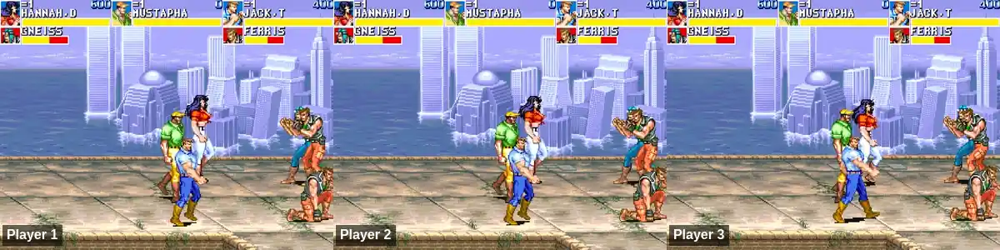
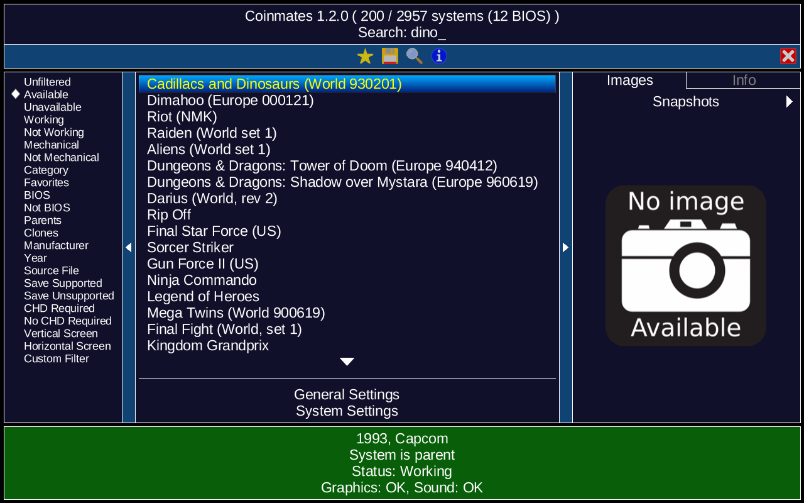
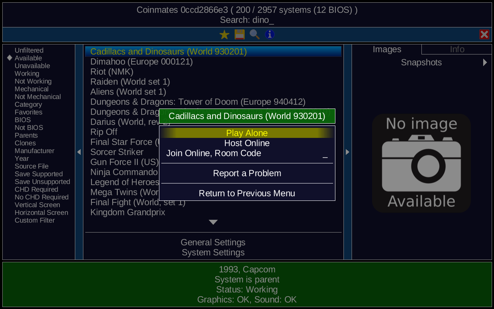
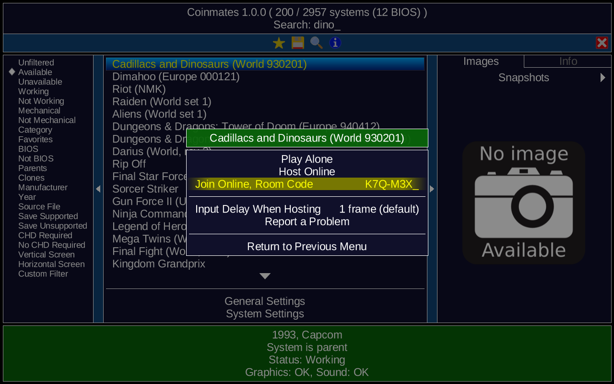
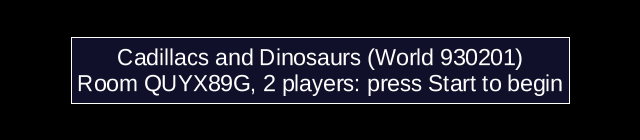
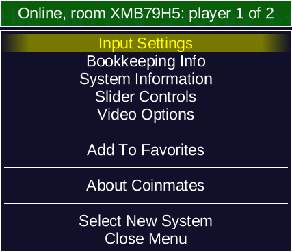
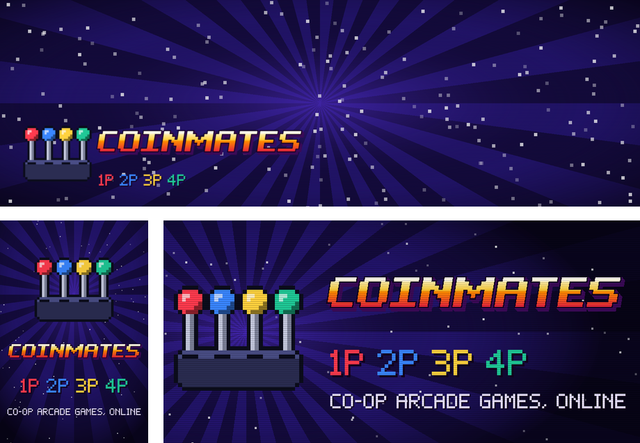

# Coinmates

Co-op arcade games with your friends, online. Coinmates is based on [MAME](https://www.mamedev.org/) and lets 2 to 4 players beat up, shoot and race through the arcade co-op classics over the internet, without the input lag of classic netplay. It uses rollback, like modern fighting games: your inputs act at once, and when a friend's input arrives late, the last few frames are quietly redone. With friends far away, or a computer that can't redo many frames, the inputs wait a little, by themselves: just enough for the game not to slow down.



- **Linux, Steam Deck, Windows and Mac**, all the same, and playing together.
- **No accounts, no servers to run**: the host gets a 7-character room code, and the others type it in.
- **Whoever drops out can join again**, and the game goes on meanwhile.
- **Players at home** find each other even without internet.
- **A controller or the keyboard**, ready to play. Folders and controls are the ones [EmuDeck](https://www.emudeck.com/) uses for MAME: if you have EmuDeck, there is nothing to set up. It isn't needed.

## Install

**Linux and Steam Deck.** Download [coinmates.flatpakref](https://mcerina.github.io/coinmates/coinmates.flatpakref) (on the Steam Deck, in Desktop Mode) and open it from *Downloads*: Discover, or your system's software center, shows Coinmates: *Install*. Or in a terminal:

```sh
flatpak install --from https://mcerina.github.io/coinmates/coinmates.flatpakref
```

Its updates come with the others, in Discover's *Updates* (or `flatpak update`). On the Steam Deck, to have it in Game Mode, add it to Steam while still in Desktop Mode: Steam → *Games* → *Add a Non-Steam Game to My Library…* → tick **Coinmates** → *Add Selected Programs*; then give it [its artwork](#artwork-in-steam-optional).

**Windows.** Download [coinmates-windows.zip](https://github.com/mcerina/coinmates/releases/latest/download/coinmates-windows.zip), unzip it where you like, and open `coinmates.exe` in the `Coinmates` folder. Windows doesn't know who made it, so the first time it says *Windows protected your PC*: *More info* → *Run anyway*. To update, unzip the new release over the old folder: each game's settings stay, while the controls set for all games, `ui.ini` and `coinmates.ini` go back to the release's.

**Mac.** Download [coinmates-macos.zip](https://github.com/mcerina/coinmates/releases/latest/download/coinmates-macos.zip) for Apple silicon (M1 or newer), or [coinmates-macos-intel.zip](https://github.com/mcerina/coinmates/releases/latest/download/coinmates-macos-intel.zip) for an Intel Mac (Apple menu → *About This Mac* says which), open it, and drag **Coinmates** to Applications. It needs macOS 11 Big Sur or newer. It isn't signed by Apple, so the first time macOS refuses to open it: System Settings → *Privacy & Security* → *Open Anyway*. To update, replace it with the new one.

When you host for the first time, your system may ask whether Coinmates can accept connections (on Windows, the firewall): allow it.

## ROMs

ROMs are not included. Coinmates looks for them in the `Emulation` folder of your home: `~` below is `/home/<you>` on Linux and the Steam Deck, `C:\Users\<you>` on Windows, `/Users/<you>` on a Mac.

| What | Where |
|---|---|
| Games | `~/Emulation/roms/arcade` |
| BIOS | there, or in `~/Emulation/bios` or `~/Emulation/bios/mame` |
| Samples | `~/Emulation/storage/mame/samples` |

If you don't have it, create `Emulation/roms/arcade` and put the zips there (the Mac version creates it at the first start). On Linux and the Steam Deck, `Emulation` can also be on an SD card or another drive, under `/run/media`. On Windows, if it is elsewhere, change the paths in `coinmates.ini`, next to `coinmates.exe`.

Every player needs **the same ROMs** for the game: the sets of MAME 0.289. When they differ, the host refuses the player and says why. Some games also need the zip of a BIOS or of a sound chip, for example `qsound_hle.zip` for Cadillacs and Dinosaurs: Coinmates says which one is missing. To check a game's ROMs:

| System | Command |
|---|---|
| Linux, Steam Deck | `flatpak run io.github.mcerina.Coinmates -verifyroms <game>` |
| Windows | in the `Coinmates` folder: `coinmates.exe -verifyroms <game>` |
| Mac | `/Applications/Coinmates.app/Contents/MacOS/launch -verifyroms <game>` |

`<game>` is MAME's short name, such as `dino`.

### Which games

The 256 co-op games checked online are in [netplay/games.txt](netplay/games.txt). Other versions of them, and other games of the same arcade boards, also show up and play online, but nobody checked them: if one shows `Repairing a desync`, [report it](#report-a-problem).

## Play

Open Coinmates and pick a game: the list shows the ones you have. Type to search (on the Steam Deck, Steam + X opens the keyboard).



Choose the game with A (or Enter), then:



- **Play Alone**: the game, just you.
- **Host Online**: you host. A room code appears: send it to your friends, in your usual chat.
- **Join Online, Room Code**: type the code a friend sent you, then A or Enter (on the Steam Deck's keyboard, R2). Upper or lower case: it doesn't matter.
- **Report a Problem**: see [below](#report-a-problem).

Games for one player only, or with analog controls (wheels, dials, trackballs), have just *Play Alone* and *Report a Problem*.



Everybody picks **the same game**.

### Hosting

The screen stays black while you wait, with the game and the room code:


The screen counts who joins. Press **Start** when everybody is in, or the game begins by itself when the room is full.



Online everybody plays with the host's settings, which can't change once the room is open: set them before, in *Play Alone*. Most games have them in the menu, under *DIP Switches* (some 4-player games need the 4-player cabinet, to play with 3 or 4); others, such as Cadillacs and Dinosaurs, in their own service menu: F2, or Select + R3, and leave it as the game says, so that it saves them.

### Joining

Finding the room takes a few seconds, without any server of ours: the players find each other through public BitTorrent trackers. Then you wait for the host:


### Leaving and joining again

When a player leaves, the others play on: that player's character stands still, and the screen says `Player 2 left`. The place stays free. If the host leaves, the game ends for everybody.

- **You lost the connection**: Coinmates notices in about 10 seconds, and joins again by itself: the screen says `Lost the connection: joining room K7QM3XD again`.
- **You quit, or Coinmates closed**: open it again, pick the same game, and *Join Online* with the same room code.
- **Somebody new** can take a free place the same way.

Joining a game already going takes a few seconds (`catching up with the game`), then you play from where the others are. Whoever forgot the code can ask anyone still playing: it is at the top of the menu.



### Controls

Everybody plays with the **player 1 controls**, whichever player they are in the game: coin and start go to their own place. The controls are EmuDeck's, made for Linux and the Steam Deck: on Windows and Mac a controller may number its buttons otherwise, and then you set them in the menu, under *Input Settings*. The names below are those of an Xbox-style controller.

| Action | Controller | Keyboard |
|---|---|---|
| Move | D-pad or left stick | arrows |
| Buttons 1, 2, 3, 4 | X, A, B, Y | Ctrl, Alt, Space, Shift |
| Buttons 5, 6 | L1, R1 | |
| Coin | Select | 5 |
| Start | Start | 1 |
| Menu | Select + R3 | Tab |
| Quit the game | Select + Start | Esc |

Select + R3 also presses the cabinet's Service button, as in EmuDeck: playing alone, some games then show their test screen.

Online, the menu doesn't pause the game: the others play on while your character stands still. Pause, save states, reset, fast forward and the Service button are off.

### Who can join

Only who knows the room code: every packet is signed with a key made from it. Typing the host's address instead of the code works only on the same local network (on a hotel's Wi-Fi, strangers too) or when both are on Tailscale.

When you join, the host's machine state is loaded on yours, and MAME isn't made to load states from people who want to harm you: **play with people you know**. On Linux and the Steam Deck, Coinmates runs in the flatpak sandbox: of your files, it sees only the `Emulation` folder and the SD cards and other drives, which it can't change, and `Documents/Coinmates` for the room logs.

## Troubleshooting

When a game ends because of a problem, the reason shows up in red in the list of games.

**Room not found after 25 seconds**: the message says where it stopped.
- `cannot reach the trackers, where rooms are found`: check the internet connection.
- `room not found: nobody is announcing this code`: check the code and the game, and that the host is still waiting.
- `found the room, but the host does not answer`: a router or firewall is in the way: use [Tailscale](#tailscale), or let the other player host.

**`refused by the host: …`** says why:
- `different Coinmates version`: everybody updates to the latest release.
- `different game`: the message says which game the host is playing.
- `different ROM contents`: your ROMs for that game differ, see [ROMs](#roms).
- `the room is full`, or `the game has already started, with every place taken`: wait for a place to be free, or for the next game.
- `cannot connect to the other players`: you reached the host but not another player: use Tailscale between the two of you.
- `this game's state is too big to join during it`: for a few games, join only before the host starts.

**`no answer from the host`**, joining by address: check the address, and that the host is waiting.

**`lost the connection, and could not join again`**: the room is gone (the host left), or the connection is still down.

**The controls react a little late**: with a friend far away, or a computer that can't keep up, the inputs wait a few frames on purpose, so that the game doesn't slow down.

**`Repairing a desync`**: the players drifted apart. It repairs itself with a small jump; if it happens often, report it.

### Tailscale

When a direct connection doesn't work:
1. Both install it, from [tailscale.com/download](https://tailscale.com/download).
2. The host shares their computer with the other player (*Share* in the Tailscale admin console), or invites them to their network.
3. Whoever joins types the host's Tailscale address, starting with `100.`, instead of the code.

### Report a problem

Pick the game, then **Report a Problem**: the browser opens a short form, with no account needed, already filled in with the game, the version, the system and the room log of the last online game with it (the last lines of each player, if it's long). Write what happened, and send it: the answers aren't public. It works for a problem playing alone too, then without a log.

One report is enough for the whole room. The room logs are in `Documents/Coinmates` (on a Mac, `~/Library/Logs/Coinmates`), without anybody's address; only the last 10 are kept, so report soon.

## Artwork in Steam (optional)

Only if you added Coinmates to Steam, on any system: Steam has no pictures for the games added by hand, and shows a grey cover; on Linux and the Steam Deck, no icon either. To give Coinmates its own, once (on the Steam Deck, in Desktop Mode):



1. Download [coinmates-steam-art.zip](https://github.com/mcerina/coinmates/releases/latest/download/coinmates-steam-art.zip), and extract it.
2. In Steam's *Library*, right click on Coinmates → *Properties…* → *Customization*: **Cover** `coinmates-cover.png`, **Background** `coinmates-background.png`, **Logo** `coinmates-logo.png`, **Wide Cover** `coinmates-wide-cover.png`.
3. **Icon**, on Linux and the Steam Deck: in *Properties…*, the empty square next to Coinmates' name → `coinmates-icon.png`. The square stays empty until Steam restarts: *Steam* → *Exit*, then open it again.

## Build from source

With flatpak-builder and the Flathub remote:

```sh
git clone https://github.com/mcerina/coinmates.git
cd coinmates
flatpak-builder --user --install --install-deps-from=flathub --force-clean build netplay/flatpak/io.github.mcerina.Coinmates.yml
```

This builds only the drivers of the co-op games ([netplay/sources.txt](netplay/sources.txt)); the first build takes a while. The Windows and macOS builds are in [.github/workflows/coinmates.yml](.github/workflows/coinmates.yml).

How it works: [src/emu/rollback.cpp](src/emu/rollback.cpp) (saving, predicting and redoing frames) and [src/emu/netplay.cpp](src/emu/netplay.cpp) (rooms, players and the network).

## License

Coinmates is a fork of MAME and keeps its license: the GNU General Public License, version 2 or later; see [COPYING](COPYING). The math functions come from [CORE-MATH](https://core-math.gitlabpages.inria.fr/), and `fma` from [musl](https://musl.libc.org/), under the MIT license: see [3rdparty/core-math/LICENSE](3rdparty/core-math/LICENSE) and [3rdparty/musl/COPYRIGHT](3rdparty/musl/COPYRIGHT). The controller mapping is [EmuDeck](https://github.com/dragoonDorise/EmuDeck)'s, under the GNU General Public License version 3: see [netplay/flatpak/EMUDECK-LICENSE](netplay/flatpak/EMUDECK-LICENSE). MAME is a registered trademark of Gregory Ember; Coinmates is not affiliated with the MAME team. MAME's own README is at [github.com/mamedev/mame](https://github.com/mamedev/mame#readme).
